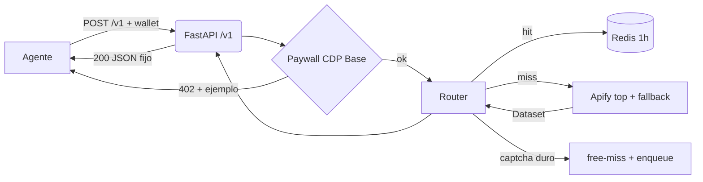
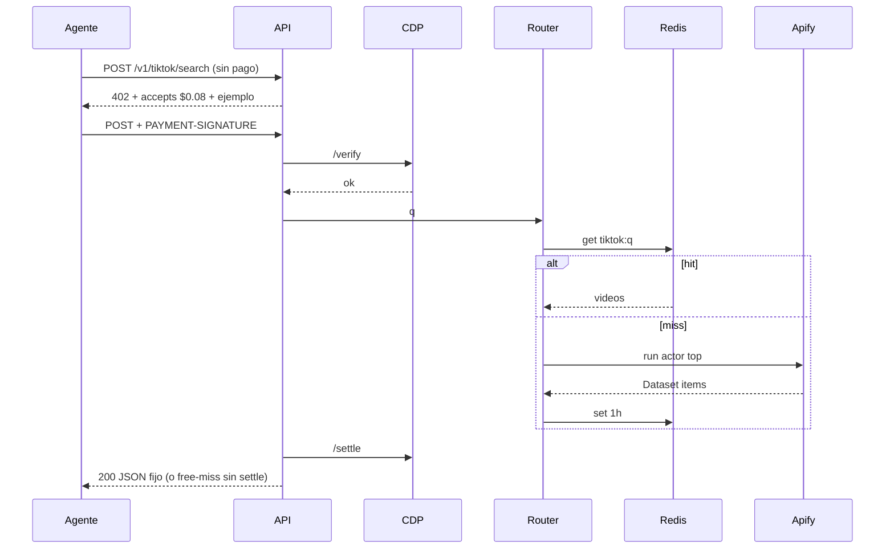

# Design Document — tiktok-bridge

## Overview
Puente x402 que vende TikTok público a agentes con 1 fetch + wallet. Reusa paywall CDP Base de Veredicto, añade router Apify curado + caché Redis 1h + discovery Bazaar/MCP.
**Users**: agentes trend/UGC/casting que hoy pagan Apify con cuenta o fallan con captcha.
**Impact**: de mock en 41243 a `/v1` cobrado con free-miss y 10 buyers recurrentes como éxito.

### Goals
- 1 call $0.08 sustituye 6 calls Apify; hit <2s, miss 30-40s.
- Free-miss si 0 resultados; nunca 500 por captcha.
- Margen ≥3x con log de coste; retención ≥70%.

### Non-Goals
- Login/privado/paywall-bypass, adulto, dashboard, Maps/IG (otros specs).

## Boundary Commitments

### This Spec Owns
- Contrato `/v1/tiktok/*` + schemas + ejemplos + precios + free-miss.
- Router (actorIds, polling, Dataset, normalización, fallback, caché).
- Paywall Base/CDP + ledger + rate-limit wallet + idempotency.
- Discovery Bazaar + 3 tools MCP + observabilidad.

### Out of Boundary
- Cuentas/wallets de clientes, proxies propios, video re-host, veredictos crypto.

### Allowed Dependencies
- AGENTE COMPARADOR `server.py` (patrón paywall/CDP/A2A/MCP, solo lectura).
- Apify Store (actors), Scrapfly ASP (fallback), Redis, CDP facilitator, Bazaar.
- Prohibido depender de testnets en contrato público.

### Revalidation Triggers
- Cambio shape contrato, cambio dueño dato (caché→otro store), cambio dirección dependencia (router→sync puro), cambio prerequisito runtime (Redis obligatorio).

## Architecture

### Existing Architecture Analysis
Veredicto: FastAPI + `@app.middleware("http")` quota IP + paywall CDP + A2A/MCP + Caddy. Se preserva patrón paywall/ledger/MCP; se elimina dominio crypto. Deuda: sin enqueue, sin switch actor, sin coste/log.

### Architecture Pattern & Boundary Map

- Selected pattern: gateway síncrono con backend async oculto + caché.
- Boundaries: contract / router / paywall / discovery en módulos separados.
- Existing patterns preserved: middleware HTTP, ledger `settled_by_facilitator`, A2A/MCP.
- New: router, caché `redis.asyncio`, enqueue 202, healthcheck actor.
- Steering compliance: spec es contrato, código es verdad.

### Technology Stack
| Layer | Choice / Version | Role in Feature | Notes |
|-------|------------------|-----------------|-------|
| Backend | FastAPI + uvicorn, Python 3.11 | `/v1` + middleware + OpenAPI auto | gotcha: `@app.middleware("http")` solo `http`, orden exterior→interior |
| Pagos | cdp SDK `create_facilitator_config`, `PaymentMiddlewareASGI`, `ExactEvmServerScheme`, Base `eip155:8453` USDC | verify/settle | wallet separada Veredicto; testnets fuera |
| Router | httpx + Apify REST runs/datasets | run async oculto, polling 30s | input fijo; nunca exponer actorId |
| Cache | `redis.asyncio.Redis`, TTL 3600, key `tiktok:*` | hit 2s coste 0 | gotcha: `await aclose()` explícito, pool auto |
| Descubrimiento | Bazaar extension + MCP Streamable | listing + 3 tools | ejemplo output real obligatorio |

## File Structure Plan
```
src/
├── server_v1.py          # FastAPI /v1 + middleware + paywall + discovery
├── tiktok_router.py      # EXISTE: ampliar con run/poll/normaliza/fallback/coste
├── cache.py              # redis.asyncio client + get/set TTL + keys
├── paywall.py            # _methods/challenge/verify/settle/ledger (reuso Veredicto)
├── discovery.py          # Bazaar OutputConfig + MCP tools + openapi/llms/skill
└── server_min.py         # mock actual: queda como fixture tests, no prod
tests/
└── test_contract.py      # schemas + free-miss + ejemplos 402
```
### Modified Files
- `src/tiktok_router.py` — de normalización pura a router completo (run, poll, fallback, coste).
- Nuevo resto; `server_min.py` no se toca en prod.

## System Flows

Decisiones: timeout 60s → 202 + retry-hint; captcha → free-miss + enqueue; idempotency evita doble-settle.

## Requirements Traceability
| Requirement | Summary | Components | Interfaces | Flows |
|-------------|---------|------------|------------|-------|
| 1 | contrato /v1 + free-miss | server_v1, discovery | API, MCP | seq |
| 2 | paywall $0.08/.08/.05 | paywall, ledger | 402/verify/settle | seq |
| 3 | router + fallback + caché | tiktok_router, cache | Apify REST | seq |
| 4 | middleware + límites | server_v1 | HTTP 429 | — |
| 5 | discovery + solo-público | discovery | Bazaar/MCP | — |

## Components and Interfaces
| Component | Domain | Intent | Req | Deps | Contracts |
|-----------|--------|--------|-----|------|-----------|
| server_v1 | API | expone /v1 + middleware | 1,4 | paywall P0, router P0 | API |
| paywall | pagos | 402/verify/settle/ledger | 2 | CDP P0 | API |
| tiktok_router | integración | run/poll/normaliza/fallback/coste | 3 | Apify P0, Redis P0 | Service |
| cache | datos | get/set TTL | 3 | Redis P0 | State |
| discovery | growth | Bazaar/MCP/ejemplos | 1,5 | — | API |

### API Contract
| Method | Endpoint | Request | Response | Errors |
|--------|----------|---------|----------|--------|
| POST | /v1/tiktok/search | {q, max=20} | {videos[]} | 400,402,429 |
| POST | /v1/tiktok/perfil | {user} | {user,bio,followers,ultimos} | 400,402,429 |
| POST | /v1/tiktok/comments | {id,max=50} | {id,comments[]} | 400,402,429 |

## Data Models
- `Video {id, desc(≤280), autor, likes, fecha, hashtags[], cover}`; `Perfil {user,bio,followers,ultimos[]}`; `Comment {autor,texto,likes}`.
- Caché Redis string JSON, TTL 3600, keys `tiktok:search:{q}:{max}`, `tiktok:perfil:{user}`, `tiktok:comments:{id}`.
- Ledger `ventas.jsonl` solo `settled_by_facilitator=true`.

## Error Handling
- 400 input inválido; 402 sin pago o pago inválido con `how`; 429 rate-limit; 202 miss largo con retry-hint; free-miss 200 con `free_miss:true` sin settle; 502 facilitador caído con mensaje, nunca traza interna.
- Monitoring: `/health`, `/stats` con token (ventas, retos, hits/miss, coste medio, retención).

## Testing Strategy
- Unit: normalización dataset→schema, free-miss, precios constantes, idempotency.
- Integration: mock Apify→router→caché, CDP verify/settle en testnet (no prod), middleware 429.
- E2E: 1 query real cacheada → 402 → pago test → 200 con ejemplo; captcha simulado → free-miss.
- Performance: hit <2s p95, miss <60s con 202; 50 req/min sin degradar.

## Security Considerations
- Solo público; login/privado → free-miss. APIFY_TOKEN y CDP keys en env gitignorado. `STATS_TOKEN` obligatorio. Sin re-host video. Terms +18 genérico, robots/sitemap.

## Performance & Scalability
- Hit sirve 1000/mes a $0.08 = $80 base coste ~0; miss cuesta ~$0.015 (margen 5x). Redis 1h + normalización O(n). Escala horizontal sin estado salvo Redis.
